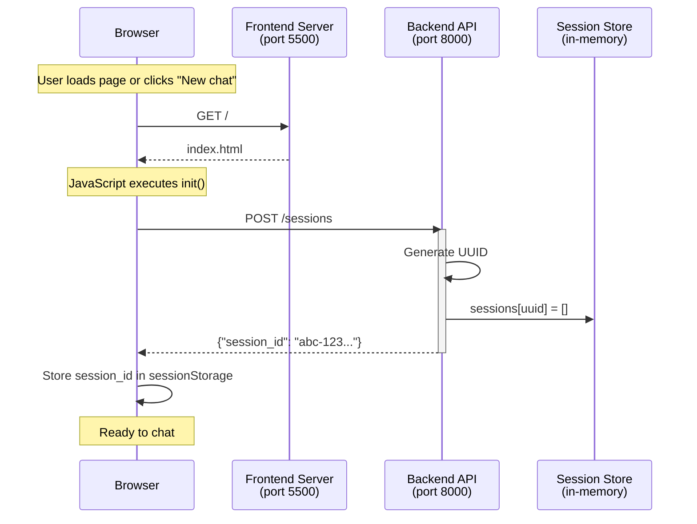
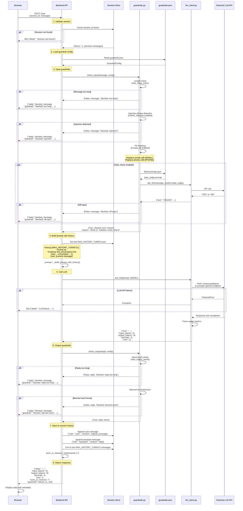
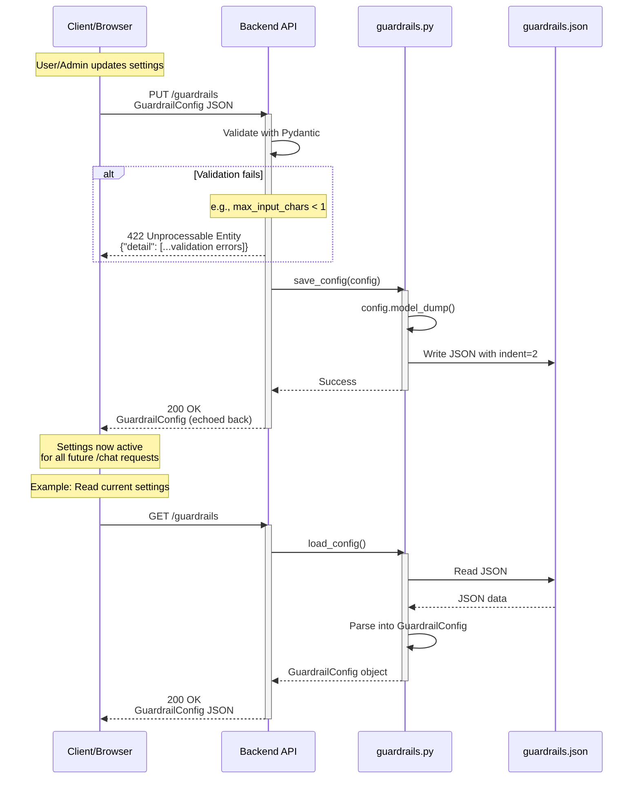
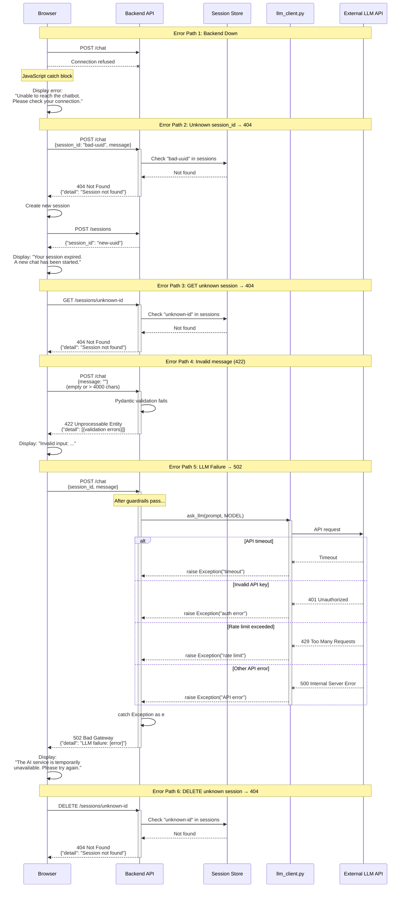

# Chatbot Sequence Diagrams

This document contains sequence diagrams showing the request flows for the chatbot application.

## 1. Starting a Session



## 2. Sending a Message (Full Flow with Guardrails and History)



## 3. Changing Guardrails with PUT /guardrails



## 4. Error Paths



---

## Validation Notes

All diagrams validated for:
- Correct Mermaid syntax (sequenceDiagram)
- Accurate representation of actual code in backend/main.py, guardrails.py, llm_client.py
- Inclusion of MAX_HISTORY_TURNS logic (last N turns from history)
- Input guardrail checks (length, injection, PII masking, topic)
- Output guardrail checks (word count, banned words)
- Error handling (404, 422, 502)
- Session storage operations
- LLM API call flow and metrics

## Key Implementation Details

### MAX_HISTORY_TURNS Behavior
From `backend/main.py:134-135`:
```python
recent_history = history[-(MAX_HISTORY_TURNS * 2):]
```
This takes the last `MAX_HISTORY_TURNS * 2` messages (each turn = user + assistant pair).

### Prompt Format
From `backend/main.py:149`:
```python
prompt = "Continue this conversation:\n\n" + "\n\n".join(conversation)
```

### Guardrail Execution Order
1. **Input guardrails** (before LLM):
   - Length check → Injection detection → PII masking → Topic check (optional)
2. **LLM call**
3. **Output guardrails** (after LLM):
   - Word count → Banned words

### Blocked Messages
From `backend/main.py:91, 104`:
- Blocked messages return immediately with `blocked_message`
- They are **NOT** saved to the session history
- Return structure includes `guardrail: reason` field
